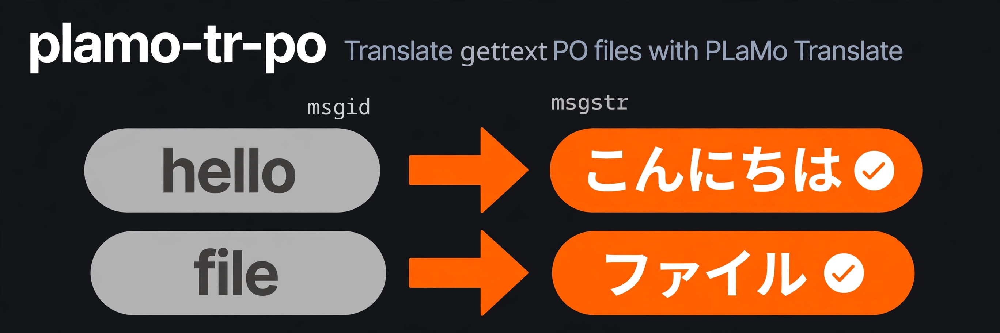

<p align="center">
  
</p>

<p align="center"><strong>Translate gettext PO files with PLaMo Translate</strong></p>

<p align="center">
  <a href="https://github.com/conao3/rust-plamo-tr-po/actions/workflows/ci.yml"></a>
  <a href="LICENSE"></a>
  <a href="https://github.com/conao3/rust-plamo-tr-po/stargazers"></a>
</p>

<p align="center">
  <a href="#usage">Usage</a> ·
  <a href="#command-line">Command line</a> ·
  <a href="#install">Install</a> ·
  <a href="#development">Development</a>
</p>

# plamo-tr-po

plamo-tr-po fills gettext PO files with machine translations from [PLaMo Translate](https://translate.preferredai.jp/). It calls PLaMo Translate through the [plamo-tr](https://github.com/conao3/rust-plamo-tr) library and writes the translations back into your PO files.

- It translates untranslated entries and the fuzzy entries it translated on an earlier run, and leaves your hand-written translations alone.
- With `--format html`, it keeps code, key bindings, and the other tags of HTML msgids as they are.
- It saves the files while it runs, so you can stop a long run and pick it up later.

plamo-tr-po is an unofficial tool and isn't affiliated with Preferred Networks.

## Usage

```console
$ plamo-tr-po po-file translate-po-files --source-language en --format html --skip-context "<(pre|style|script)>" --po-files po/emacs.ja.po
108 distinct msgids in 108 entries to translate; 13 entries skipped by --skip-context; 0 fuzzy entries with a human translation left as is
{
  "PoFiles": [
    "po/emacs.ja.po"
  ],
  "DryRun": false,
  "PendingMsgidCount": 108,
  "PendingEntryCount": 108,
  "SkippedEntryCount": 13,
  "HumanFuzzyEntryCount": 0,
  "TranslatedMsgidCount": 108,
  "RejectedMsgidCount": 0
}
```

Add `--dry-run` to count the entries to translate without calling PLaMo Translate or touching the files.

### What it changes in your PO files

plamo-tr-po edits the files in place:

- It translates untranslated entries, and fuzzy entries that it translated before. It gives each translation the translator comment `# Machine-translated by PLaMo Translate.` and removes the `fuzzy` flag and the previous msgid (`#|`).
- A fuzzy entry without that comment holds a human translation. plamo-tr-po leaves it for a person to review. After you correct a machine translation by hand, remove the comment from the entry.
- It translates each msgid once, even when the msgid appears in several entries or files.
- It writes the lines of entries that don't get a new translation back unchanged.
- It takes the target language from the `Language` header of each file unless you give `--target-language`.
- It writes progress to stderr and saves the files every `--save-every` seconds, so an interrupted run keeps what it translated. It prints the summary to stdout when the run ends.

When PLaMo Translate rejects a batch or the request fails, plamo-tr-po retries it one msgid at a time. If PLaMo Translate still rejects a msgid's translation, plamo-tr-po leaves the msgid untranslated, and tools such as po4a keep the original text for it.

### Parameters

| Parameter | Meaning |
|---|---|
| `--po-files <PATH>...` | PO files to translate in place (space-separated). Required. |
| `--source-language <LANG>` | Source language of the msgids. PLaMo Translate detects it when you omit it. |
| `--target-language <LANG>` | Target language. Defaults to the `Language` header. |
| `--format <plain\|html>` | Markup of the msgids. With `html`, plamo-tr-po sends the contents of `code`, `kbd`, `pre`, `samp`, and `var` elements as placeholders and keeps them as they are, and rejects a translation that changes the other tags. |
| `--skip-context <REGEX>` | Leave entries untranslated when an extracted comment (`#.`) matches, such as `<pre>` for code blocks that po4a extracts. |
| `--batch-size`, `--batch-chars` | How many msgids and characters go into 1 request (20 and 4000). |
| `--jobs` | Requests in flight (4). |
| `--limit <N>` | Stop after N distinct msgids. |
| `--save-every <SECONDS>` | Interval between saves (60). |
| `--dry-run` / `--no-dry-run` | Only count the entries to translate. |
| `--auth-file <PATH>` | Login file of PLaMo Translate (`PLAMO_AUTH_FILE`). The plamo-tr README shows how to create it. |

### Command line

Commands follow the AWS CLI grammar: `plamo-tr-po [global options] <command> <subcommand> [--parameter value ...]`.

- plamo-tr-po reads a value starting with `file://` from that file, and `file:///dev/stdin` reads standard input.
- `--cli-input-json file://input.json` passes the parameters as a JSON object keyed by the PascalCase parameter names (`{"PoFiles": ["po/emacs.ja.po"], "DryRun": true}`). Parameters on the command line take precedence. `--generate-cli-skeleton input|output` prints the input or output skeleton.
- Global options: `--output json|text|table` (default `json`), `--query <JMESPath>`, `--debug`, `--version`.
- `help` works at each level: `plamo-tr-po help`, `plamo-tr-po po-file help`, `plamo-tr-po po-file translate-po-files help`.

| Exit code | Meaning |
|---|---|
| 0 | Success. |
| 252 | Invalid command or parameter, including a missing `--auth-file`. |
| 254 | A PO file can't be read or parsed, or has no usable `Language` header, or the sign-in to PLaMo Translate fails. |
| 255 | Other failures, such as an unreadable auth file. |

## Install

```console
$ nix run github:conao3/rust-plamo-tr-po -- help
$ cargo install --git https://github.com/conao3/rust-plamo-tr-po
```

## Development

```console
$ nix develop
$ make check
```

`make check` runs `nix fmt -- --ci`, `cargo clippy --all-targets -- -D warnings`, and `cargo test`. The tests don't call PLaMo Translate.

## License

Apache-2.0
